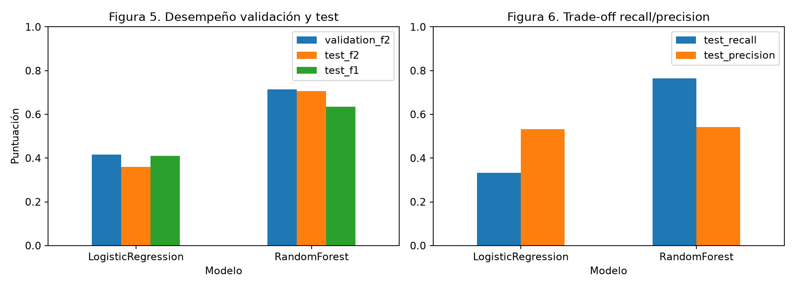
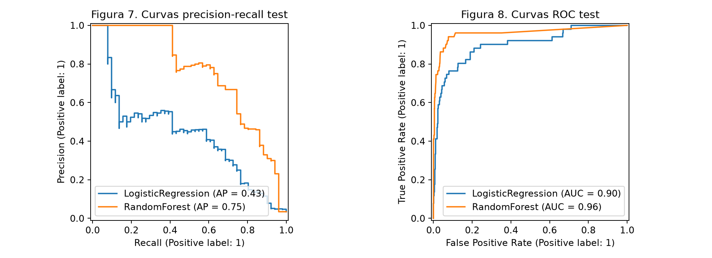
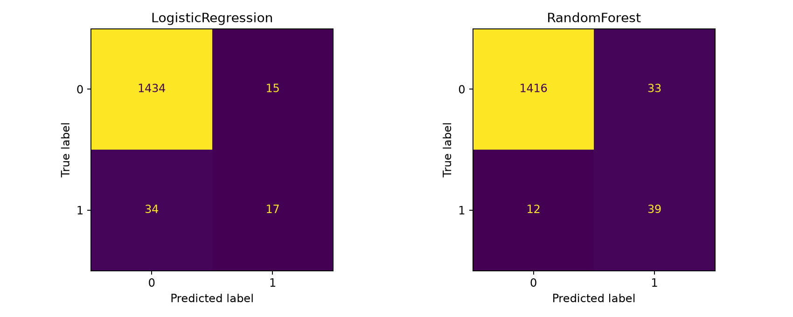

# Predictive Maintenance AI — Actividad 5

**Asignatura:** Gestión de Proyectos de Inteligencia Artificial · Módulo 2, semana 6  
**Entorno principal:** Windows, Python 3.13.5 y MLflow 3.17.1

> **Estado:** entrenamiento completo y auditado en Windows 11 (Python 3.13.5, MLflow 3.17.1). Se publicaron 17 runs, métricas, datos preparados, figuras y seis capturas reales de MLflow. El reporte técnico PDF se incorpora a `docs/`.

## 1. Resumen y problema
Clasificación binaria de **fallas presentes** en máquinas sintéticas mediante Regresión Logística y Random Forest. Se realiza limpieza trazable, GridSearchCV, validación cruzada estratificada, MLflow, comparación estadística y análisis de deuda MLOps. No se afirma capacidad de anticipar fallas futuras ni validez en producción.

## 2. Datos y versión
**La carpeta de datos iniciales contiene dos versiones trazables:** el [CSV oficial completo de UCI (14 columnas)](datos/datos_ini/uci_ai4i2020_original.csv), descargado de [AI4I 2020 (DOI 10.24432/C5HS5C)](https://doi.org/10.24432/C5HS5C) bajo licencia CC BY 4.0, y el [snapshot académico de siete columnas](datos/datos_ini/ai4i2020.csv) conservado de la [Actividad 4](https://github.com/isaaccg88/PredictiveMaintenance-AI-Activity4). El experimento utiliza solamente seis variables predictoras y la etiqueta binaria, con las [particiones originales congeladas](datos/splits.csv). No se modificó el entrenamiento para incorporar el CSV adicional.

**Validación de procedencia:** el script [`verificar_fuente_uci.py`](fuentes/verificar_fuente_uci.py) comprobó **10,000 filas × siete columnas, cero discrepancias fila por fila** entre el dataset original y el snapshot utilizado. El [manifiesto de procedencia](docs/uci_source_manifest.json) conserva los SHA256, nombres exactos y el mapa de variables. Se excluyeron `UDI` y `Product ID` por ser identificadores y `TWF/HDF/PWF/OSF/RNF` porque describen modos de falla directamente ligados a la etiqueta y supondrían fuga de información si se usaran para predecirla.

| Comprobación inicial | Valor confirmado |
|---|---:|
| Registros | 10,000 |
| Fallas | 339 (3.39%) |
| Duplicados exactos | 0 |
| Filas con campos vacíos o categorías inválidas | 0 |
| Train / validación / test | 7,000 / 1,500 / 1,500 |
| Errores entre splits y etiquetas | 0 |

El pipeline produce un dataset preparado, hashes SHA256, reporte de calidad e histogramas. La imputación, One-Hot Encoding y normalización se ajustan **dentro de cada fold**, mediante scikit-learn Pipeline, para prevenir contaminación de test.

## 3. Resultados empíricos e interpretación técnica

**Selección previa a la prueba:** RandomForest, umbral 0.20, decidido exclusivamente por validación. La comparación de los mejores modelos se encuentra en [resultados/comparacion_modelos.csv](resultados/comparacion_modelos.csv) y las predicciones individuales en [resultados/predicciones_test.csv](resultados/predicciones_test.csv).

| Indicador | Regresión logística | Random Forest |
|---|---:|---:|
| Average Precision CV (5 folds) | 0.4793 | **0.7347** |
| F2 en validación | 0.4167 | **0.7143** |
| Umbral seleccionado | 0.30 | 0.20 |
| Accuracy en test | 0.9673 | **0.9700** |
| Balanced Accuracy en test | 0.6615 | **0.8710** |
| Precisión en test | 0.5313 | **0.5417** |
| Recall en test | 0.3333 | **0.7647** |
| F1 en test | 0.4096 | **0.6341** |
| F2 en test | 0.3602 | **0.7065** |
| Average Precision en test | 0.4322 | **0.7518** |
| ROC-AUC en test | 0.9007 | **0.9602** |
| Verdaderos positivos | 17 | **39** |
| Falsos negativos | 34 | **12** |
| Falsos positivos | **15** | 33 |
| Tiempo Grid Search (s) | **4.48** | 25.90 |
| Latencia inferencia (ms/registro) | **0.0067** | 0.0366 |

**Figura 5-6 - métricas y trade-off.** 

**Figuras 7-8 - áreas PR y ROC.** 

**Figura 9 - matrices de confusión.** 

La matriz de confusión es el argumento central: Random Forest identificó **22 fallas más** (39 contra 17) y redujo las omisiones de **34 a 12** (64.7%), al precio de **18 falsas alarmas adicionales** (33 contra 15). La pequeña ventaja en accuracy no explica la magnitud de la mejora: incluso un clasificador que predice siempre "sin falla" consigue **96.6% de accuracy**, pero recall cero, como demuestra [baseline_dummy.json](resultados/baseline_dummy.json).

**Incertidumbre:** en [bootstrap_pareado.csv](resultados/bootstrap_pareado.csv), la diferencia observada F1(RandomForest) - F1(LogisticRegression) es **0.2245**; el intervalo percentil de 95% de 2,000 remuestreos pareados es **[0.0897, 0.3668]**. Este intervalo excluye cero en el test examinado, pero el número de fallas reales es 51 y el dataset es sintético: no equivale a garantía de desempeño industrial.

**Generalización:** la mejor configuración de Random Forest alcanzó Average Precision de entrenamiento cercana a **1.0**, versus **0.7347** en validación cruzada; es señal potencial de sobreajuste que obliga a validar con nuevos datos reales. En rendimiento computacional, la búsqueda de Random Forest tardó unas 5.8 veces más que la de regresión logística, en el entorno observado.

**Calidad de datos y anomalías:** el IQR identifica 418 valores extremos en velocidad de rotación y 69 en torque. No se eliminaron arbitrariamente porque podrían representar condiciones anómalas útiles para identificar fallas. Las figuras descriptivas están en [resultados/figuras/](resultados/figuras/).

## 4. Arquitectura experimental

| Dimensión | Configuración |
|---|---|
| Baseline | DummyClassifier, clase mayoritaria |
| Modelos | LogisticRegression y RandomForestClassifier |
| Ajuste | GridSearchCV, validación cruzada estratificada de 5 folds |
| Semilla | 42 |
| Métrica primaria de Grid Search | Average Precision, por desbalance |
| Rejilla logística | C = 0.1, 1, 10; class_weight = None, balanced |
| Rejilla Random Forest | 120 / 240 árboles; profundidad 8 / libre; min_samples_leaf 1 / 5 |
| Total | 14 combinaciones, 70 ajustes CV y refit final |
| Selección | Umbral y modelo basados **solo en validación**, F2 con precision mínima de 0.50 si es posible |
| Métricas test | Accuracy, balanced accuracy, precision, recall, F1, F2, AP, ROC-AUC y latencia |
| Estadística | Bootstrap pareado de diferencia F1, 2,000 remuestreos |
| MLflow | Un run padre por modelo y un run hijo por candidato de Grid Search; modelos y artefactos registrados |

## 5. Organización de la entrega

| Carpeta o archivo | Finalidad |
|---|---|
| [datos/datos_ini/](datos/datos_ini/) | Snapshot inalterado del dataset académico |
| [datos/datos_limp/](datos/datos_limp/) | Dataset preparado, se genera al ejecutar |
| [fuentes/datos_prep.py](fuentes/datos_prep.py) | Limpieza, calidad, hashes y EDA |
| [fuentes/train.py](fuentes/train.py) | Modelos, Grid Search, selección y MLflow |
| [fuentes/evaluation.py](fuentes/evaluation.py) | Métricas y umbrales |
| [fuentes/entrena.ipynb](fuentes/entrena.ipynb) | Notebook de entrenamiento Jupyter / Colab; plantilla reproducible |
| [fuentes/Evidencia_Ejecutada_Actividad5.ipynb](fuentes/Evidencia_Ejecutada_Actividad5.ipynb) | Notebook de auditoría con salidas reales de ejecución, **sin reentrenar**; comprueba datos, predicciones, bootstrap y runs |
| [fuentes/export_evidencias.py](fuentes/export_evidencias.py) | Runs MLflow en CSV/JSON |
| [fuentes/generar_reporte.py](fuentes/generar_reporte.py) | Crea el reporte PDF con cifras reales |
| [resultados/](resultados/) | CSV, figuras, calidad y bootstrap |
| [evidencias/mlflow/](evidencias/mlflow/) | Capturas **reales** y runs exportados |
| [docs/](docs/) | Protocolo y reporte PDF académico |
| [CHANGELOG.md](CHANGELOG.md) | Registro de cambios y decisiones |
| [tests/](tests/) | Pruebas automáticas |

## 6. Reproducción local (Windows)

Mantener el servidor MLflow iniciado en la ventana PowerShell existente, desde la carpeta personal MLflow-Actividad5, con este comando:

```powershell
.\.venv\Scripts\mlflow.exe server --host 127.0.0.1 --port 5000 --backend-store-uri sqlite:///mlflow.db
```

Abre el repositorio con **GitHub Desktop > Repository > Show in Explorer**. En el Explorador de Windows, escribe **powershell** en la barra de direcciones para abrir una **segunda ventana** ubicada en la raíz del repositorio. Ejecuta los comandos siguientes, en orden:

**5.1. Instalar dependencias del proyecto:**

```powershell
& "$HOME\MLflow-Actividad5\.venv\Scripts\python.exe" -m pip install -r requirements.txt
```

**5.2. Ejecutar pruebas de la lógica de evaluación:**

```powershell
& "$HOME\MLflow-Actividad5\.venv\Scripts\python.exe" -m unittest discover -s tests -v
```

**5.3. Entrenar los modelos y registrar los runs MLflow** (puede tardar varios minutos):

```powershell
& "$HOME\MLflow-Actividad5\.venv\Scripts\python.exe" -m fuentes.train --tracking-uri http://127.0.0.1:5000
```

**5.4. Exportar el historial reproducible de MLflow:**

```powershell
& "$HOME\MLflow-Actividad5\.venv\Scripts\python.exe" -m fuentes.export_evidencias --tracking-uri http://127.0.0.1:5000
```

**5.5. Capturar el panel MLflow.** Abre http://127.0.0.1:5000, selecciona **Model training** y documenta los **17 runs** con 2–3 capturas consecutivas (`01_experimentos.png`, `01_experimentos_02.png`, `01_experimentos_03.png`). Añade también las otras tres evidencias técnicas de Grid Search, comparación y modelos; instrucciones en [evidencias/mlflow/README.md](evidencias/mlflow/README.md). Las capturas adicionales del listado se incorporan automáticamente al PDF. El profesor no puede abrir el localhost de tu equipo.

**5.6. Crear el PDF con los resultados y capturas obligatorias:**

```powershell
& "$HOME\MLflow-Actividad5\.venv\Scripts\python.exe" -m fuentes.generar_reporte --require-screenshots
```

El archivo final será **docs/Reporte_Tecnico_Actividad5.pdf**. Revisarlo visualmente, añadir interpretación profunda al README/CHANGELOG y publicar el commit final a GitHub. Los CSV y figuras se generan desde el código y son trazables a la ejecución de Windows ya publicada. Si se vuelve a ejecutar, los resultados y el PDF deben actualizarse juntos.

### Notebook alternativo en Colab
[**Abrir notebook de Actividad 5**](https://colab.research.google.com/github/isaaccg88/PredictiveMaintenance-AI-Activity5/blob/main/fuentes/entrena.ipynb).

En Colab se crea un SQLite en su propio runtime. **El localhost de Colab no es el localhost de tu Windows**; por ello las capturas pedidas por el profesor se obtendrán más fácilmente con la ejecución local.

## 7. MLflow, trazabilidad y evidencias
Se publicaron **17 runs** (1 baseline, 2 padres de modelos, 14 candidatos de Grid Search) con sus parámetros, métricas y archivos. El archivo [runs_exportados.csv](evidencias/mlflow/runs_exportados.csv) conserva los identificadores verificables; [runs_manifest.json](evidencias/mlflow/runs_manifest.json) describe la exportación, y se añadieron seis imágenes reales del panel. Las capturas documentan la interfaz del servidor MLflow del estudiante; su base SQLite local no se sube al repositorio.

## 8. Riesgos y acciones MLOps
La alta desproporción de clases exige reportar precision, recall, AP y falsos negativos, no solo accuracy. Limitaciones: dataset sintético, sin horizonte temporal ni validación prospectiva por máquina. Futuro: monitoreo de drift, nuevas particiones temporales, calibración, registro y promoción controlada de modelos, revisión humana, políticas de reversión y auditoría de alertas.

## 9. Formato de entrega
La entrega acordada es **la URL del repositorio GitHub**, que contendrá código, notebook, datos, métricas, **reporte PDF** y evidencias de MLflow. No se entregará ZIP. **Pendiente:** entrenamiento local real, capturas, PDF, interpretación de métricas y auditoría final.

## 10. Declaración de uso de IA

| Herramienta | Actividades | Responsabilidad |
|---|---|---|
| ChatGPT (OpenAI) | Asistencia en diseño experimental, programación, depuración, documentación y revisión de GitHub | El estudiante ejecuta los experimentos, verifica los artefactos y decide la interpretación final; las métricas se derivan de código reproducible. |

## 11. Referencias
- UCI AI4I 2020: https://doi.org/10.24432/C5HS5C
- Scikit-learn: https://scikit-learn.org/stable/
- MLflow Tracking: https://mlflow.org/docs/latest/ml/tracking/
- Protocolo: [docs/protocolo_experimental.md](docs/protocolo_experimental.md)

## 12. Controles de cierre académico y portabilidad

Se preservó un respaldo de la versión previa a la auditoría en la rama `respaldo-actividad5-previo-a-auditoria-final`. El entrenamiento original y sus métricas no fueron modificados. La evidencia de ejecución del cuaderno `Evidencia_Ejecutada_Actividad5.ipynb` se obtiene auditando los CSV/JSON publicados en un runtime de GitHub Actions independiente; **no sustituye ni pretende simular la ejecución local del notebook de entrenamiento**. Los hashes SHA256 byte a byte pueden cambiar al normalizar finales de línea CRLF/LF entre Windows y Linux, por lo que se distingue la identidad del contenido tabular y la firma de archivos específicos del entorno.
